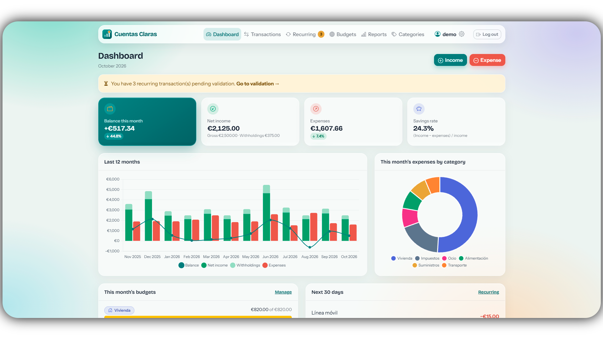
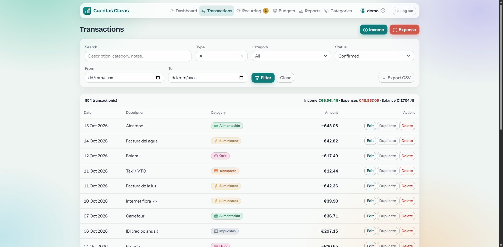
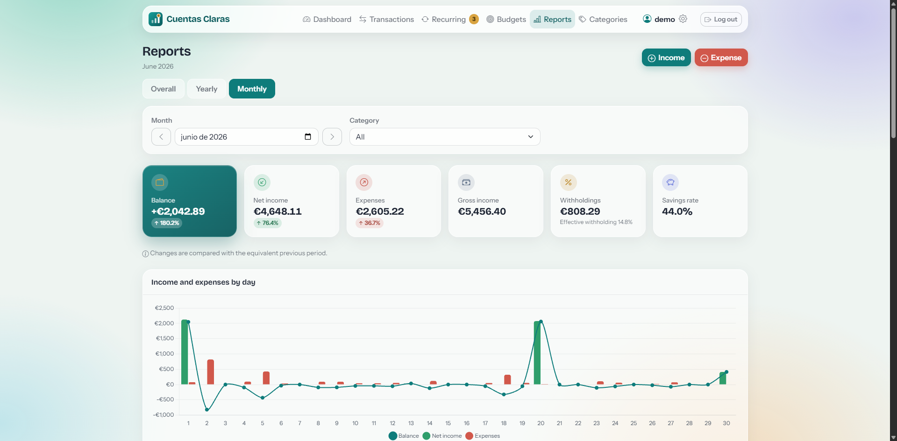
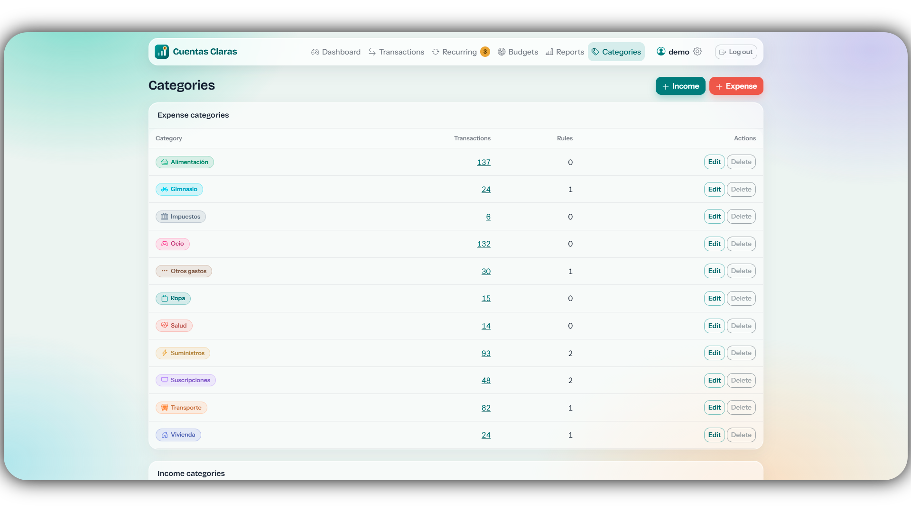
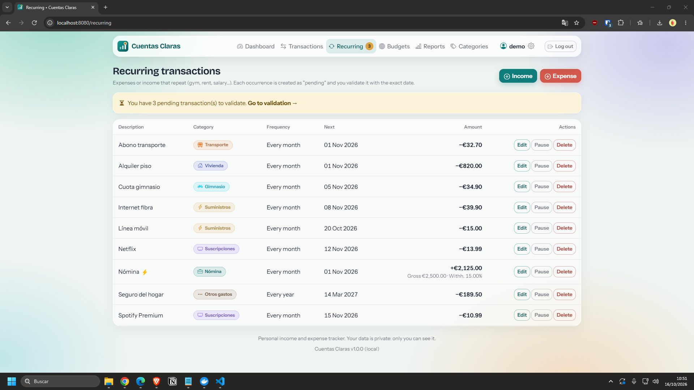

# Zero Doubt

**A web application for managing your monthly income and expenses.**

Built with PHP 8.5.12 and MySQL 8.4, and deployed using Docker Compose. It follows the same architecture (controllers, models, views, custom routing, no framework), UI style, and conventions as [TR Tracking](https://github.com/ForgeRGX/TR-Tracking).

<p align="center">
  
  
  
</p>

## Screenshots

Add screenshots of the application below to showcase its main features and user interface.

### Dashboard



### Transactions



### Reports and Charts



### Categories and Budgets



### Recurring Transactions



## Features

### Core Features

- **Monthly income and expense tracking**, including descriptions, dates, categories, and notes.
- **Global, yearly, and monthly charts and reports** (available under the *Reports* section), with date filtering:
  - **Global:** Custom date ranges and shortcuts (3, 6, or 12 months, current year, or all time).
  - **Yearly:** Year-by-year navigation, a category-by-month matrix, and comparison with the previous year.
  - **Monthly:** Daily breakdown, largest expenses of the month, and budget progress.
  - All reports can be filtered by category and compared with the equivalent previous period.
- **Custom income and expense categories**, each with its own color and icon. Default categories are created when a user registers and can be edited or deleted.
- **Gross and net income with withholding calculations.** When recording income, you can choose how to enter the amounts:
  1. Net amount only.
  2. Gross amount + withholding percentage → the net amount is calculated automatically.
  3. Gross amount + net amount → the withholding amount and percentage are calculated automatically.

  Charts use net income (the amount actually received). Gross income and withholdings are displayed separately, including the effective withholding rate for the selected period. Each income category can have a default withholding rate (e.g. 15% for payroll income).
- **Recurring expenses and income with validation.** Define a rule such as "Gym, €50, every month, starting January 5." Each overdue occurrence is created as a **pending transaction**. You can validate it by specifying the actual date and amount, confirm the expected values with a single click, or use *Validate All*. Pending transactions are excluded from charts until validated.

  Supported frequencies: weekly, biweekly, monthly, bimonthly, quarterly, semiannual, and annual. Rules can have an optional end date, be paused and resumed, and optionally use automatic confirmation.
- **Multi-user support:** Each user can only access and manage their own data. All database queries are scoped to the current user.

### Additional Improvements

- **Monthly budgets by expense category**, with progress bars and overspending alerts.
- **Dashboard** showing the current month's balance, change compared with the previous month, savings rate, upcoming recurring transactions (next 30 days), and pending transactions awaiting validation.
- **Transaction search and filters** by type, category, status, date range, and text, with pagination and **CSV export**.
- **Duplicate transactions** and a quick-add button.
- **Spanish and English support**, with date and amount formatting adapted to the selected language, password changes, and user settings.
- **Security:** Password hashing, CSRF protection, login attempt limits by IP address and username, `HttpOnly`/`SameSite` cookies, prepared SQL statements, security headers, and an option to disable registration.
- **Backups:** `scripts/backup.sh` and `scripts/restore.sh`.
- Optional phpMyAdmin, accessible only from the local machine.

## Requirements

- Docker Engine and Docker Compose v2.
- A `.env` file containing the required credentials, created from `.env.example`.

## Installation

```bash
# 1. Configure the environment
cp .env.example .env
# Update the passwords and other credentials as needed

cp docker-compose.yml.example docker-compose.yml

# 2. Build and start the containers
docker compose build
docker compose up -d

# 3. Open http://localhost:8080 and create your account
```

- The database schema (`database/schema.sql`) is applied automatically **the first time the application starts with an empty database volume**.
- If no users exist, registration remains open so you can create the first account. After that, set `ALLOW_REGISTRATION=false` in `.env` and run `docker compose up -d` to disable new registrations.
- **phpMyAdmin:** [http://localhost:8081](http://localhost:8081) (configured through the `PMA_PORT` variable and bound to `127.0.0.1`).
- To display detailed errors, set `APP_DEBUG=true` in `.env`. Do not enable this setting in production.

### Useful Commands

```bash
docker compose logs --tail=100 web      # Application logs
scripts/lint.sh                         # PHP syntax and translation checks (no rebuild required)
scripts/backup.sh                       # Create backups/zero_doubt_YYYY-MM-DD.sql
scripts/restore.sh backups/file.sql     # Restore a backup
php scripts/check_translations.php      # Check for untranslated English strings
```

## How Recurring Transactions Work

1. Go to **Recurring → New Rule** and define the transaction type, category, description, expected amount, frequency, and first occurrence date.
2. Whenever you access the application (at most once per hour), overdue occurrences are created as **pending transactions**. A unique constraint on `(rule, scheduled date)` prevents duplicates.
3. Under **Pending Validation**, you can:
   - **Validate:** Confirm the expected amount and date.
   - **Review:** Change the actual date and amount before validating.
   - **Skip:** Omit that occurrence.
4. If the first occurrence is scheduled for the 31st, shorter months use their last day. The schedule returns to the 31st when possible.
5. Resuming a paused rule does not generate missed occurrences for the period during which it was paused.
6. Deleting a rule removes its pending transactions but preserves transactions that have already been validated.

## Project Structure

```text
zero-doubt/
├── config/          # Configuration and route definitions
├── controllers/     # Controllers
├── core/            # Router, views, authentication, i18n, helpers
├── database/        # SQL schema
├── docker/          # Apache configuration
├── lang/            # Translations (en.php; Spanish is the base language)
├── models/          # Data access and statistics
├── public/          # Entry point and static assets (CSS, JS, images)
├── scripts/         # Backup, restore, lint, and translation checks
├── views/           # Templates
├── Dockerfile
└── docker-compose.yml.example
```

### Data Model

| Table | Contents |
|---|---|
| `users` | Users, password hashes, and language preferences |
| `categories` | User-specific income and expense categories (color, icon, default withholding rate) |
| `transactions` | Transactions: `amount` (net income), `gross_amount`, withholding, `confirmed`/`pending` status, source rule, and scheduled date |
| `recurring_rules` | Recurring rules and their next scheduled date |
| `budgets` | Monthly budgets by expense category |
| `login_attempts` | Failed login attempts for brute-force protection |

## License

To be determined.
